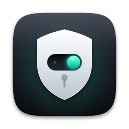
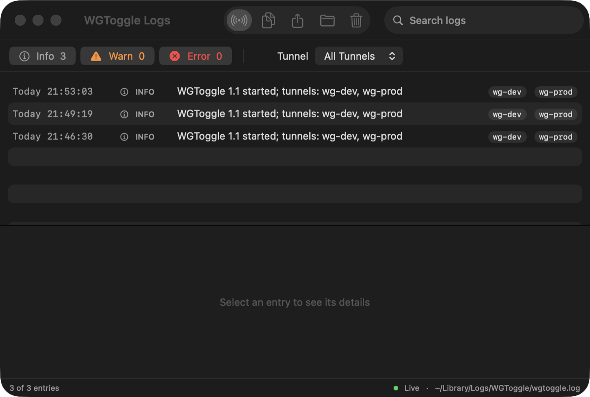

<p align="center"></p>

<h1 align="center">WGToggle</h1>

A small native macOS menu bar app for running **several WireGuard tunnels at the same time** with `wg-quick`. Turn tunnels on one at a time or all together, and add new ones without opening a terminal.

<p align="center">
  <a href="https://github.com/ppodolak/wgtoggle/actions/workflows/build.yml"></a>
  <a href="https://github.com/ppodolak/wgtoggle/releases/latest"></a>
  <a href="https://github.com/ppodolak/wgtoggle/releases"></a>
  
  
  <a href="LICENSE"></a>
  <a href="https://buymeacoffee.com/ppodolak"></a>
</p>

---

## Contents

- [Features](#features)
- [Install](#install)
- [Usage](#usage)
- [Running multiple tunnels](#running-multiple-tunnels)
- [Logs](#logs)
- [Security](#security)
- [Build from source](#build-from-source)
- [Project layout](#project-layout)
- [Troubleshooting](#troubleshooting)
- [Support](#support)

---

## Features

- Menu bar status: monochrome icon that matches light and dark menu bars: outline = all down, half = some up, filled = all up. Hover to see which tunnels are up.
- Toggle one or all: click a tunnel to turn it on or off, or use **Connect All** / **Disconnect All**.
- Add tunnels: import several `.conf` files at once, paste a config from your VPN portal, or drag files onto the app icon.
- Conflict checks: warns before saving a config whose `AllowedIPs` overlap another tunnel, that routes `0.0.0.0/0`, or that sets a global `DNS =`.
- Hook approval: shows `PostUp`/`PreUp`/… commands and asks you before they run as root (see [Security](#security)).
- Self-installing: runs `brew install wireguard-tools` in the background if `wg-quick` is missing.
- Live progress: the menu bar icon pulses and steps through outline → half → filled while a tunnel connects or disconnects, and the menu shows *Connecting wg-dev…*.
- Notifications: a banner on connect, on disconnect (including changes made in a terminal) and on errors. Click an error to open the Log Explorer. Can be turned off in the menu.
- Log Explorer: a native window with search, Info/Warn/Error filters, a tunnel filter, live updates, a detail pane, and copy/export/clear (**⌘L**).
- Launch at Login: one click, using the system's `SMAppService`.
- Show in Dock: optional Dock icon. Click it to open the Log Explorer; right-click it to toggle tunnels. Off by default (menu bar only).

## Install

1. Download the latest **`WGToggle-x.y.z.dmg`** from [Releases](https://github.com/ppodolak/wgtoggle/releases/latest), open it then drag **WGToggle** into **Applications**.
2. Launch it. A shield appears in the menu bar. The app has no Dock icon.
3. *(Optional)* Turn on **Launch at Login** from the menu.

> **Requirements:** macOS 13 or later and [Homebrew](https://brew.sh). `wireguard-tools` is installed automatically if it's missing.

> **Gatekeeper:** the app is ad-hoc signed, not notarized. The first time, right-click the app and choose **Open**, or run `xattr -dr com.apple.quarantine /Applications/WGToggle.app`.

Each release includes a `.sha256` file you can use to check the download: `shasum -a 256 -c WGToggle-x.y.z.dmg.sha256`.

## Usage

```
 ┌──────────────────────────────┐
    │ Tunnels                      │
    │ wg-dev                     │  ← click to turn on/off
    │ wg-prod                    │
    ├──────────────────────────────┤
    │ Connect All                  │
    │ Disconnect All               │
    ├──────────────────────────────┤
    │ Import Config Files…         │
    │ Add Tunnel (Paste Config)…   │
    │ Remove Tunnel              ▸ │
    │ Open Config Folder           │
    │ Log Explorer…            ⌘L  │
    │ Show in Dock                 │
    │ Notifications                │
    │ Launch at Login              │
    ├──────────────────────────────┤
    │ Buy Me a Coffee…             │
    ├──────────────────────────────┤
    │ Quit                     ⌘Q  │
    └──────────────────────────────┘
```

- Configs live in **`/opt/homebrew/etc/wireguard/`** on Apple Silicon or `/usr/local/etc/wireguard/` on Intel. `/etc/wireguard/` is read too.
- The tunnel name is the file name. wg-quick only accepts names of up to **15 characters** (`A–Z a–z 0–9 _ = + . -`). When importing, you'll be asked to rename anything longer.
- Connecting or disconnecting shows the standard macOS admin password dialog. macOS remembers the password for a few minutes.

## Running multiple tunnels

Several tunnels work side by side when they meet these conditions:

1. **They are split tunnels.** `AllowedIPs` lists only the internal networks, never `0.0.0.0/0`.
2. **Their `AllowedIPs` don't overlap** with each other or with your local network.
3. **No tunnel sets a global `DNS =`.** On macOS, wg-quick then sends every DNS lookup to that server. Use per-domain DNS instead:

   ```ini
   [Interface]
   # DNS = 10.0.0.53, 10.0.0.54, corp     ← remove this line
   PostUp   = mkdir -p /etc/resolver && printf "nameserver 10.0.0.53\nnameserver 10.0.0.54\n" > /etc/resolver/corp
   PostDown = rm -f /etc/resolver/corp
   ```

   With this, only `*.corp` names go to the VPN's DNS. Everything else keeps using your normal DNS.

   > Use `ping`, `curl` or `dscacheutil -q host -a name host.corp` to test. `dig` and `nslookup` skip `/etc/resolver` and will wrongly say the name doesn't exist.

WGToggle checks rules 1–3 when you add a tunnel.

## Logs

### Log Explorer



Menu → **Log Explorer…** (⌘L) opens a native window:

- **Search** across messages and the full wg-quick output
- **Level toggles** for Info, Warn and Error, each with a count
- **Tunnel filter**: show only the entries that mention `wg-dev`, `wg-prod`, …
- **Live** updates every second while new entries arrive (can be paused)
- **Detail pane** showing the full, selectable text of the selected entry
- **Copy Visible**, **Export…** (saved readable only by you), **Reveal in Finder**, **Clear**
- Right-click an entry to copy it or filter by its tunnel

| Where | How to view |
|---|---|
| `~/Library/Logs/WGToggle/wgtoggle.log` | **Log Explorer**, or `tail -f ~/Library/Logs/WGToggle/wgtoggle.log` |
| Unified log | `log stream --predicate 'subsystem == "local.wgtoggle"' --info` or Console.app |

What gets logged: app start and quit, tunnel up/down (including changes made outside the app), the output of every `wg-quick` call, imports, removals, hook approvals or rejections, and Homebrew installs.
The log file is `0600` (readable only by you) and rotates at 1 MB, keeping one backup (`wgtoggle.log.1`).
**Config contents, private keys and preshared keys are never logged.**

```
2026-11-26T20:46:30.086Z INFO  WGToggle 1.1 started; tunnels: wg-dev, wg-prod
2026-11-26T20:47:02.511Z INFO  wg-quick up: wg-dev
2026-11-26T20:47:04.020Z INFO  wg-quick up ok
[#] wireguard-go utun
...
2026-11-26T20:47:05.190Z INFO  wg-dev is now UP
```

## Security

WGToggle starts commands as root, so it was reviewed for security problems. Here is what was found and how each issue is handled.

### Threat model

A config is a secret (it holds your private key), and it's also code (wg-quick runs its hooks as **root**). The main danger is **something running as your user getting root** through a tunnel config.

### Findings and fixes

| # | Risk | Severity | Fix |
|---|---|---|---|
| 1 | **Root code in hooks.** wg-quick runs `PreUp/PostUp/PreDown/PostDown` as root via bash. The Homebrew config folder is writable by your user, so any process running as you could add a hook and wait for your next admin prompt. | High | Before **every** up or down, the config is re-read. If it has hooks and its SHA-256 isn't on the approved list, the exact hook lines are shown and you must click **Allow**. A changed file needs approval again. |
| 2 | **Shell injection** through file names or paths in the root command. | Medium | Tunnel names must match `^[a-zA-Z0-9_=+.-]{1,15}$`, and anything else in the folders is ignored. Every path is single-quote escaped for the shell and again for AppleScript. |
| 3 | **Symlink/TOCTOU attacks when saving.** A root `chmod` or `cp` on a path someone else can change could hit an unrelated file. | Medium | Writable folder: the app writes a `0600` temp file in the same folder, then `rename()`s it into place atomically, so a symlink at the target is replaced, not followed. Root-owned folder: `install -m 600` writes a new file, with no `chmod` on a path that can be swapped. |
| 4 | **Private key exposure** through file permissions or logs. | Medium | Configs are always saved `0600`. The log folder is `0700` and the log file `0600`. Config contents are never logged. |
| 5 | **Silent DNS or traffic capture.** An imported config with `DNS =` or `0.0.0.0/0` takes over your DNS or all your traffic. | Low | You're warned when the config is added and must confirm. |
| 6 | **Oversized or garbage imports.** | Low | Files over 64 KB, non-UTF-8 files, and files without `[Interface]`, `PrivateKey` and `[Peer]` are rejected. |
| 7 | **Broken CIDRs in the overlap check.** | Info | Bad input is treated as "no overlap" and prefix lengths are capped at 32, so the check can't crash. |

### Remaining risks (by design)

- **The approved-hash list is stored in the app's user defaults**, which your user can edit. Malware already running as you could pre-approve its own hooks. Hook approval stops casual tampering and mistakes. It can't stop a determined attacker that already runs as your user, and nothing that relies on an admin prompt can.
- **The admin authorization is cached for a few minutes** after you type your password, as with any app that uses `do shell script … with administrator privileges`.
- **Configs in `/etc/wireguard`** are root-owned and the app can't read them, so their hooks can't be shown. They're trusted because only root can write there.
- **The app is ad-hoc signed and not notarized.** Build it yourself, or check where your copy came from.
- **`brew install`** runs as your user and trusts Homebrew's own security.

### Recommendations

- Only import configs from a source you trust, such as your organisation's VPN portal.
- Read the hook dialog. Your own split-DNS hook should be just `mkdir`/`printf`/`rm` on `/etc/resolver/<domain>`.
- For stricter isolation, keep configs in root-owned `/etc/wireguard` (`sudo install -m 600 x.conf /etc/wireguard/`).

## Build from source

```bash
git clone https://github.com/ppodolak/wgtoggle.git
cd wgtoggle
./build.sh          # → build/WGToggle.app and build/WGToggle.dmg
```

CI (`.github/workflows/build.yml`) builds every push and pull request. Pushing a tag like `v1.3.0` builds with that version and publishes a GitHub Release with the DMG and its checksum:

```bash
git tag v1.3.0 && git push origin v1.3.0
```

The build needs the Xcode Command Line Tools (`xcode-select --install`). It compiles separate arm64 and x86_64 binaries, merges them with `lipo`, draws the icon from an SF Symbol, ad-hoc signs the app, and packs the DMG.

## Project layout

```
WGToggle/
├── README.md
├── build.sh                  # build, sign, package
├── Sources/
│   ├── main.swift            # menu bar app, tunnels, import, security checks, logging
│   ├── LogExplorer.swift     # SwiftUI log window
│   └── Notify.swift          # connect/disconnect/error notifications
├── Resources/
│   ├── Info.plist            # LSUIElement, .conf document type
│   └── make-icon.swift       # draws the app icon in code (squircle, shield and toggle)
└── build/                    # output (generated)
```

## Troubleshooting

| Symptom | Fix |
|---|---|
| Tunnel shows as up but hosts don't respond | Run `sudo wg show` and check `latest handshake` and `transfer`. If data goes out but almost nothing comes back, the same config is probably active on another device; turn it off there and toggle the tunnel. |
| `Name too long` / interface error | Rename the file to 15 characters or fewer. |
| Internet DNS breaks when a tunnel is up | The config has `DNS =`. Switch it to `/etc/resolver` (see above). |
| Internal names don't resolve | Use the full name (`host.corp`). Test with `ping` or `dscacheutil`, not `dig`. |
| Launch at Login fails | Move the app to `/Applications` first. |
| No notifications appear | System Settings → Notifications → **WGToggle** → Allow. Also check the **Notifications** item in the menu. |
| Something else | Menu → **Log Explorer…**. |

## Support

WGToggle is free and open source. If it saves you some time, you can buy me a coffee. It keeps the side projects going.

<a href="https://buymeacoffee.com/ppodolak"></a>

Bug reports and pull requests are welcome too.

## License

[MIT](LICENSE)

---

<sub>WireGuard is a registered trademark of Jason A. Donenfeld. This project is independent and not affiliated with or endorsed by the WireGuard project.</sub>
