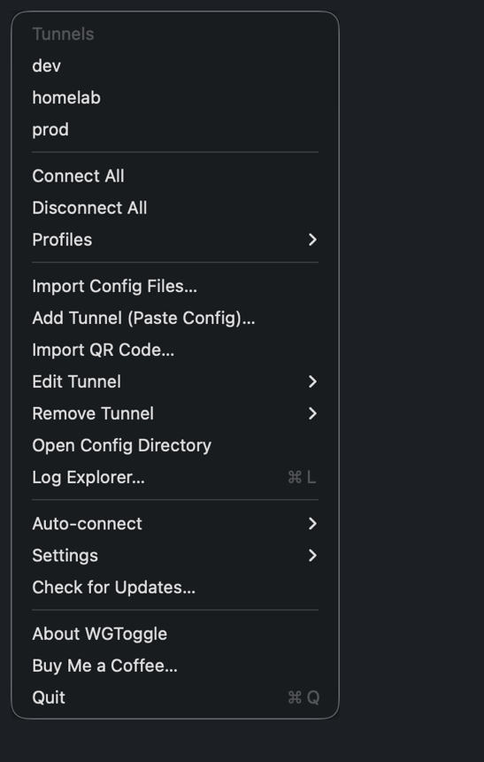
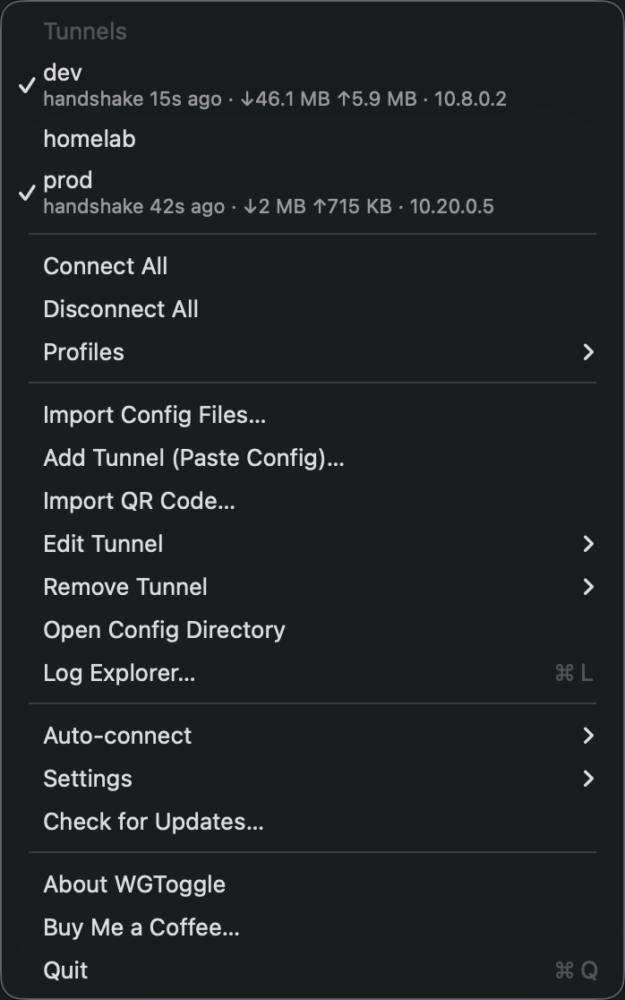
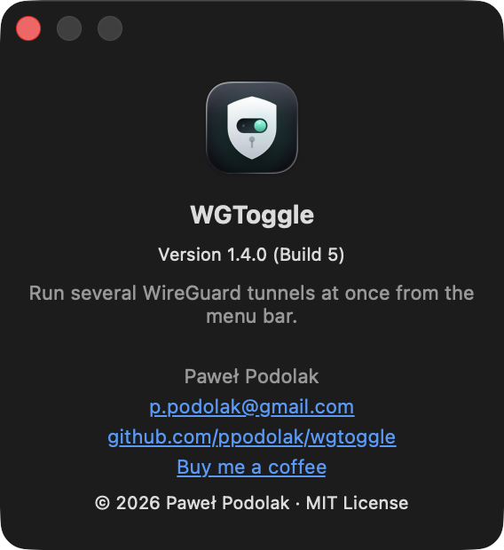

<p align="center"></p>

<h1 align="center">WGToggle</h1>

<p align="center"><b>Multiple WireGuard VPNs. One macOS menu bar.</b></p>

Run several WireGuard tunnels at the same time on macOS. Keep your development, production and private networks connected side by side and manage them from the menu bar: toggle one or all, see live traffic, catch stuck tunnels, and add new configs without opening a terminal.

```bash
brew install --cask ppodolak/tap/wgtoggle
```

<p align="center"></p>

<p align="center">
  <a href="https://github.com/ppodolak/wgtoggle/actions/workflows/build.yml"></a>
  <a href="https://github.com/ppodolak/wgtoggle/releases/latest"></a>
  <a href="https://github.com/ppodolak/wgtoggle/releases"></a>
  <a href="https://github.com/ppodolak/homebrew-tap"></a>
  
  
  <a href="LICENSE"></a>
  <a href="https://buymeacoffee.com/ppodolak"></a>
</p>

---

## Contents

- [Features](#features)
- [Install](#install)
- [Usage](#usage)
- [Why WGToggle](#why-wgtoggle)
- [Screenshots](#screenshots)
- [Running multiple tunnels](#running-multiple-tunnels)
- [Command line](#command-line)
- [Logs](#logs)
- [Passwordless mode](#passwordless-mode)
- [Security](#security)
- [Privacy](#privacy)
- [Build from source](#build-from-source)
- [Project layout](#project-layout)
- [Troubleshooting](#troubleshooting)
- [Roadmap](#roadmap)
- [Support](#support)

---

## Features

- Menu bar status: monochrome icon that matches light and dark menu bars: outline = all down, half = some up, filled = all up. Hover to see which tunnels are up.
- Toggle one or all: click a tunnel to turn it on or off, or use **Connect All** / **Disconnect All**.
- Add tunnels: import several `.conf` files at once, paste a config from your VPN portal, or drag files onto the app icon.
- Conflict checks: warns before saving a config whose `AllowedIPs` overlap another tunnel, that routes `0.0.0.0/0`, or that sets a global `DNS =`.
- Hook approval: shows `PostUp`/`PreUp`/… commands and asks you before they run as root (see [Security](#security)).
- Self-installing: runs `brew install wireguard-tools` in the background if `wg-quick` is missing.
- Live progress: the menu bar icon pulses and steps through outline → half → filled while a tunnel connects or disconnects, and the menu shows *Connecting wg-dev…*.
- Notifications: a banner on connect, on disconnect (including changes made in a terminal) and on errors. Click an error to open the Log Explorer. Can be turned off in the menu.
- Log Explorer: a native window with search, Info/Warn/Error filters, a tunnel filter, live updates, a detail pane, and copy/export/clear (**⌘L**).
- Live stats: each tunnel shows traffic, last handshake and its IP. Hold ⌥ to copy the IP.
- Health check: a tunnel is marked stuck when its handshake goes stale while traffic is flowing (passwordless mode), or when traffic goes out and nothing comes back. You get a notification, and it can be restarted automatically: after 10 s, 20 s and 40 s, then it gives up for 15 minutes. For configs with several peers, each peer is checked on its own, so one working peer doesn't hide a dead one.
- Passwordless mode: optional. Connect and disconnect without typing your password (see [Passwordless mode](#passwordless-mode)).
- Split DNS on import: a config with `DNS = …, corp` can be converted so only `*.corp` lookups use the VPN's DNS.
- Auto-connect: per tunnel, at launch. With passwordless mode also after wake, after network changes and when a tunnel drops.
- Profiles: save the current set of tunnels (for example "Work") and switch to it in one click.
- Edit tunnels and import a config from a QR code (clipboard screenshot or image file).
- Global shortcut ⌃⌥⌘T toggles all tunnels.
- Update check against GitHub Releases.
- Command line tool: `wgtoggle status --json`, `up`, `down`, `profile` (see [Command line](#command-line)).
- Launch at Login: one click, using the system's `SMAppService`.
- Show in Dock: optional Dock icon. Click it to open the Log Explorer; right-click it to toggle tunnels. Off by default (menu bar only).

## Install

With [Homebrew](https://brew.sh):

```bash
brew install --cask ppodolak/tap/wgtoggle
```

This also installs `wireguard-tools`. Update with `brew upgrade --cask wgtoggle`.

Or manually:

1. Download the latest **`WGToggle-x.y.z.dmg`** from [Releases](https://github.com/ppodolak/wgtoggle/releases/latest), open it then drag **WGToggle** into **Applications**.
2. Launch it. A shield appears in the menu bar. The app has no Dock icon.
3. *(Optional)* Turn on **Launch at Login** from the menu.

> **Requirements:** macOS 13 or later and [Homebrew](https://brew.sh). `wireguard-tools` is installed automatically if it's missing.

> **Gatekeeper:** the app is ad-hoc signed, not notarized. The first time, right-click the app and choose **Open**, or run `xattr -dr com.apple.quarantine /Applications/WGToggle.app`.

Each release includes a `.sha256` file you can use to check the download: `shasum -a 256 -c WGToggle-x.y.z.dmg.sha256`.

## Usage

Click the shield in the menu bar:

| Menu item | What it does |
|---|---|
| **wg-dev**, **wg-prod**, … | One line per tunnel with traffic, handshake and IP. A checkmark means it's up. Click to connect or disconnect. Hold ⌥ to copy the IP. |
| **Connect All** / **Disconnect All** | Bring every tunnel up or down. |
| **Profiles** ▸ | Switch to a saved set of tunnels, save the current set, or delete one. |
| **Import Config Files…** | Add one or more `.conf` files. |
| **Add Tunnel (Paste Config)…** | Paste a config and give it a name. |
| **Import QR Code…** | Read a config from a QR code on the clipboard or in an image file. |
| **Edit Tunnel** ▸ | Change a config. Overlaps, DNS and hooks are checked on save. |
| **Remove Tunnel** ▸ | Delete a tunnel (it's disconnected first). |
| **Open Config Directory** | Show the configs in Finder. |
| **Log Explorer…** `⌘L` | Open the log window. |
| **Auto-connect** ▸ | Choose which tunnels connect automatically. |
| **Settings** ▸ | Passwordless mode, restarting stuck tunnels, the global shortcut, notifications, Dock icon, Launch at Login, update checks. |
| **Check for Updates…** | Look for a newer release (shows *Update Available* when there is one). |
| **Buy Me a Coffee…** | Support the project. |
| **Quit** `⌘Q` | Quit the app. Tunnels stay up. |

- Configs live in **`/opt/homebrew/etc/wireguard/`** on Apple Silicon or `/usr/local/etc/wireguard/` on Intel. `/etc/wireguard/` is read too.
- The tunnel name is the file name. wg-quick only accepts names of up to **15 characters** (`A–Z a–z 0–9 _ = + . -`). When importing, you'll be asked to rename anything longer.
- Connecting or disconnecting shows the standard macOS admin password dialog unless passwordless mode is on.
- `WGToggle.app/Contents/MacOS/WGToggle --diagnose` prints each tunnel's state, interface, IP, traffic and health. Handy for bug reports; no keys are printed.

## Why WGToggle

The official WireGuard app for macOS is great when you need one tunnel at a time. WGToggle is for people who work across several private networks at once, like a dev VPN, a prod VPN and a home lab.

| | WGToggle | Official WireGuard app |
|---|---|---|
| Several tunnels up at the same time | Yes | One at a time |
| Uses your existing `wg-quick` configs, including `PostUp`/`PostDown` hooks | Yes | Imports configs, no hooks |
| Split DNS per domain (`/etc/resolver`) | Yes, can convert on import | No |
| Overlap and DNS conflict warnings | Yes | No |
| Stuck tunnel detection | Yes | No |
| Signed, notarized, sandboxed, App Store | Not yet (ad-hoc signed) | Yes |
| Needs Homebrew and admin rights | Yes | No |

If you only ever use one tunnel, the official app is the simpler and more locked-down choice.

## Screenshots

<p>
  
  
</p>


<sub>Screenshots use demo data (`--demo`), not real tunnels.</sub>

## Running multiple tunnels

Several tunnels work side by side when they meet these conditions:

1. **They are split tunnels.** `AllowedIPs` lists only the internal networks, never `0.0.0.0/0`.
2. **Their `AllowedIPs` don't overlap** with each other or with your local network.
3. **No tunnel sets a global `DNS =`.** On macOS, wg-quick then sends every DNS lookup to that server. Use per-domain DNS instead:

   ```ini
   [Interface]
   # DNS = 10.0.0.53, 10.0.0.54, corp     ← remove this line
   PostUp   = mkdir -p /etc/resolver && printf "nameserver 10.0.0.53\nnameserver 10.0.0.54\n" > /etc/resolver/corp
   PostDown = rm -f /etc/resolver/corp
   ```

   With this, only `*.corp` names go to the VPN's DNS. Everything else keeps using your normal DNS.

   When WGToggle converts a config for you, the hooks it writes also handle **two tunnels sharing a domain**: each running tunnel keeps its own nameservers in a marker in `/var/db/wgtoggle-dns/` (kept across reboots, so a resolver left behind by a crash is never mistaken for someone else's file). When one disconnects, the resolver is rebuilt from the newest tunnel still running (so it never points at the DNS of a tunnel that's gone), and when the last one disconnects, a resolver file that existed before is put back, otherwise it's removed. Markers are tied to the tunnel *and* its interface (checked against wg-quick's runtime file), so a dead tunnel's marker is ignored even if another VPN later gets the same `utunN`. After a crash or reboot, `wgtoggle dns repair` (and the app at launch, in passwordless mode) removes resolvers of tunnels that aren't running and restores the original.

   > Use `ping`, `curl` or `dscacheutil -q host -a name host.corp` to test. `dig` and `nslookup` skip `/etc/resolver` and will wrongly say the name doesn't exist.

WGToggle checks rules 1–3 when you add a tunnel.

## Command line

The Homebrew cask also installs `wgtoggle`:

```bash
wgtoggle list                  # tunnels and whether they're up
wgtoggle status --json         # state, interface, IP, traffic, last handshake
wgtoggle status --strict       # same, but exit 4 if any tunnel's state is unknown (for monitoring)
wgtoggle up dev prod           # connect
wgtoggle down prod             # disconnect
wgtoggle profile work          # connect exactly the tunnels in a saved profile
wgtoggle routes                # networks each tunnel routes through the VPN
wgtoggle conflicts             # overlapping routes, default routes, shared DNS domains
wgtoggle dns                   # active split-DNS resolvers
wgtoggle dns repair            # clean up resolvers left by a crashed tunnel or a reboot
wgtoggle version               # app, wireguard-tools and helper versions
wgtoggle diagnose              # status plus settings, no keys printed
```

Exit codes: `0` ok, `1` failed or problems found (handy in scripts: `wgtoggle conflicts || exit 1`), `2` usage error, `3` profile switch failed and restoring the previous tunnels also failed, `4` incomplete (`conflicts` couldn't read some configs; it names them).

`wgtoggle profile NAME` is a transaction: it changes nothing if any tunnel's state is unknown, switches under one lock, checks the result, and if the switch fails, restores the tunnels that were up before and checks that too. JSON output (`status --json`, `routes --json`) has a `"version"` field that changes only if fields are removed or renamed.

Tab completion for zsh, bash and fish is installed by the cask (commands, tunnel names, profiles). Without Homebrew, source the files in `WGToggle.app/Contents/Resources/completions/`.

The app and the CLI never change tunnels at the same time: whichever starts first holds a lock, the CLI waits up to 60 seconds, and the app tells you it's busy.

It shares settings with the app. Connecting asks for your password in the terminal unless passwordless mode is on, and configs with hooks must be approved in the app first.

## Logs

### Log Explorer

Menu → **Log Explorer…** (⌘L) opens a native window:

- **Search** across messages and the full wg-quick output
- **Level toggles** for Info, Warn and Error, each with a count
- **Tunnel filter**: show only the entries that mention `wg-dev`, `wg-prod`, …
- **Live** updates every second while new entries arrive (can be paused)
- **Detail pane** showing the full, selectable text of the selected entry
- **Copy Visible**, **Export…** (saved readable only by you), **Reveal in Finder**, **Clear**
- Right-click an entry to copy it or filter by its tunnel

| Where | How to view |
|---|---|
| `~/Library/Logs/WGToggle/wgtoggle.log` | **Log Explorer**, or `tail -f ~/Library/Logs/WGToggle/wgtoggle.log` |
| Unified log | `log stream --predicate 'subsystem == "local.wgtoggle"' --info` or Console.app |

What gets logged: app start and quit, tunnel up/down (including changes made outside the app), the output of every `wg-quick` call, imports, removals, hook approvals or rejections, and Homebrew installs.
The log file is `0600` (readable only by you) and rotates at 1 MB, keeping one backup (`wgtoggle.log.1`).
**Config contents, private keys and preshared keys are never logged.**

```
2026-11-26T22:12:01.204Z INFO  WGToggle 1.3.0 started; tunnels: wg-dev, wg-prod
2026-11-26T20:47:02.511Z INFO  wg-quick up: wg-dev
2026-11-26T20:47:04.020Z INFO  wg-quick up ok
[#] wireguard-go utun
...
2026-11-26T20:47:05.190Z INFO  wg-dev is now UP
```

## Passwordless mode

**Settings → Passwordless Mode** asks for your password once and then lets you connect and disconnect without it.

Homebrew's `wg-quick`, `wg`, `wireguard-go` and `bash` are writable by your user, so letting sudo run them without a password would give root to anything running as you. Passwordless mode avoids that:

- Root-owned copies of those four tools, plus the libraries bash needs, go into `/Library/PrivilegedHelperTools/wgtoggle/`.
- `/etc/sudoers.d/wgtoggle` allows exactly one command without a password: the helper script in that folder.
- The helper only accepts `up NAME`, `down NAME` and `status`, checks the name, and only runs configs in `/etc/wireguard/` that are owned by root and not writable by anyone else.
- Your configs are moved into `/etc/wireguard/`. Adding, editing or removing a tunnel still asks for your password.

When a WGToggle update ships a newer helper, you get a notification at launch (click it to update) and **Settings** shows **Update Passwordless Helper…** (one password prompt). Use it too after `brew upgrade wireguard-tools` to pick up the new tool versions.

The helper also lets the app check root-owned configs for conflicts: `meta NAME` returns only the `Address`, `AllowedIPs`, `DNS` and hook lines, never keys. Turning it off removes the helper and the sudoers rule; configs stay in `/etc/wireguard/`.

## Security

WGToggle starts commands as root, so it's built with a few safeguards: hook commands must be approved before they run, tunnel names are restricted, configs and logs are readable only by you, and risky configs trigger a warning.

### Threat model

A config is a secret (it holds your private key), and it's also code (wg-quick runs its hooks as **root**). The main danger is **something running as your user getting root** through a tunnel config.

### Remaining risks (by design)

- **The approved-hash list is stored in the app's user defaults**, which your user can edit. Malware already running as you could pre-approve its own hooks. Hook approval stops casual tampering and mistakes. It can't stop a determined attacker that already runs as your user, and nothing that relies on an admin prompt can.
- **By default, the admin prompt runs Homebrew's `wg-quick`**, which your user can modify, so malware running as you could swap it and wait for your next password prompt. That's the same as typing `sudo wg-quick` yourself. **Settings → Use Root-Owned wg-quick** (or passwordless mode) removes this: the app and the CLI then use root-owned copies, also when they still ask for the password.
- **Root commands never look up programs in Homebrew's folders first**: system directories come first in `PATH`, and `wg-quick` is started by absolute path with its own bash.
- **Helper installation is a transaction**: if any step fails, the previous helper, sudo rule and configs are restored (or removed on a first install).
- **Keys are stripped from logs**: `PrivateKey`/`PresharedKey` values become `<redacted>`, and any other WireGuard key is shortened to its first 4 characters.
- **Command output is private in the system log** (it shows as `<private>` in Console) and only kept in full in `~/Library/Logs/WGToggle/wgtoggle.log`, which only you can read.
- **The admin authorization is cached for a few minutes** after you type your password, as with any app that uses `do shell script … with administrator privileges`.
- **Configs in `/etc/wireguard`** are root-owned and the app can't read them, so their hooks can't be shown. They're trusted because only root can write there.
- **The app is ad-hoc signed and not notarized.** Build it yourself, or check where your copy came from.
- **`brew install`** runs as your user and trusts Homebrew's own security. The root-owned tool copies are taken from your Homebrew install; WGToggle can't verify where those files came from, because anything running as you could also change Homebrew or WGToggle itself.

### Recommendations

- Only import configs from a source you trust, such as your organisation's VPN portal.
- Read the hook dialog. Your own split-DNS hook should be just `mkdir`/`printf`/`rm` on `/etc/resolver/<domain>`.
- For stricter isolation, keep configs in root-owned `/etc/wireguard` (`sudo install -m 600 x.conf /etc/wireguard/`).

## Privacy

- No accounts, no analytics, no telemetry.
- Your configs and keys never leave your Mac. QR codes are decoded locally.
- Logs stay in `~/Library/Logs/WGToggle/` (readable only by you) and never contain keys.
- The only network request the app makes on its own is the update check: a plain request to `api.github.com` for the latest release, with no identifiers. Turn it off in **Settings → Check for Updates Automatically**.

## Build from source

```bash
git clone https://github.com/ppodolak/wgtoggle.git
cd wgtoggle
./build.sh          # → build/WGToggle.app and build/WGToggle.dmg
```

Run the tests with `Tests/run.sh`. They cover config parsing, overlap checks, split-DNS conversion, QR decoding, version comparison and the helper's input checks.

CI (`.github/workflows/build.yml`) runs the tests and builds every push and pull request. Pushing a tag like `v1.4.0` builds with that version, publishes a GitHub Release with the DMG and its checksum, and updates the cask in [ppodolak/homebrew-tap](https://github.com/ppodolak/homebrew-tap) (needs a `TAP_TOKEN` secret with write access to that repo):

```bash
git tag v1.4.0 && git push origin v1.4.0
```

The build needs the Xcode Command Line Tools (`xcode-select --install`). It compiles separate arm64 and x86_64 binaries, merges them with `lipo`, draws the icon from an SF Symbol, ad-hoc signs the app, and packs the DMG.

## Project layout

```
WGToggle/
├── README.md
├── build.sh                  # build, sign, package
├── Sources/
│   ├── main.swift            # entry point (app or command line)
│   ├── AppDelegate.swift     # app state, launch, icon
│   ├── AppDelegate+MenuBar.swift        # menu bar, Dock and app menus
│   ├── AppDelegate+TunnelActions.swift  # connect/disconnect, health, auto-connect, profiles
│   ├── AppDelegate+ConfigEditing.swift  # import, add, edit, remove configs
│   ├── AppDelegate+SettingsActions.swift # settings, passwordless mode, updates, About
│   ├── Core.swift            # tunnels, config parsing, conflicts, hook approval, logging, admin commands
│   ├── CLI.swift             # wgtoggle command line tool
│   ├── LogExplorer.swift     # SwiftUI log window
│   ├── Notify.swift          # connect/disconnect/error notifications
│   ├── Helper.swift          # passwordless mode (helper, sudoers rule, installer)
│   ├── Stats.swift           # traffic counters and stuck-tunnel detection
│   └── Features.swift        # split DNS, profiles, auto-connect, updates, shortcut, QR
├── Tests/
│   ├── run.sh                # builds and runs the self-tests
│   └── SelfTest.swift
├── Resources/
│   ├── Info.plist            # LSUIElement, .conf document type
│   └── make-icon.swift       # draws the app icon in code (squircle, shield and toggle)
└── build/                    # output (generated)
```

## Troubleshooting

| Symptom | Fix |
|---|---|
| Tunnel shows as up but hosts don't respond | Run `sudo wg show` and check `latest handshake` and `transfer`. If data goes out but almost nothing comes back, the same config is probably active on another device; turn it off there and toggle the tunnel. |
| `Name too long` / interface error | Rename the file to 15 characters or fewer. |
| Internet DNS breaks when a tunnel is up | The config has `DNS =`. Switch it to `/etc/resolver` (see above). |
| Internal names don't resolve | Use the full name (`host.corp`). Test with `ping` or `dscacheutil`, not `dig`. |
| Launch at Login fails | Move the app to `/Applications` first. |
| No notifications appear | System Settings → Notifications → **WGToggle** → Allow. Also check the **Notifications** item in the menu. |
| A private hostname doesn't resolve but the tunnel works | Your router may block public names that point to private IPs (DNS rebinding protection). Add a hook that sends that domain to another DNS server, e.g. `PostUp = mkdir -p /etc/resolver && printf 'nameserver 1.1.1.1\n' > /etc/resolver/example.com` and `PostDown = rm -f /etc/resolver/example.com`. |
| Tunnel shows a ⚠︎ stuck warning | Traffic goes out but nothing comes back. Check whether the same config is active on another device, or turn on **Settings → Restart Stuck Tunnels Automatically**. |
| Something else | Menu → **Log Explorer…**, or run `--diagnose`. |

## Roadmap

Ideas being considered, roughly in order. Suggestions welcome in [issues](https://github.com/ppodolak/wgtoggle/issues).

- [ ] Configurable health checks per tunnel (ping or HTTP to an internal host)
- [x] Command line tool: `wgtoggle status --json`, `up`, `down`, `profile`
- [x] Route and conflict view on the command line (`wgtoggle routes`, `wgtoggle conflicts`)
- [ ] Route view in the app, conflicts highlighted before connecting
- [x] Two tunnels sharing a split-DNS domain (marker-based hooks)
- [x] Root-owned tool copies without passwordless mode (**Settings → Use Root-Owned wg-quick**)
- [x] Per-peer health for configs with several peers (passwordless mode)
- [x] IPv6 overlap and `::/0` checks
- [ ] Profiles by Wi-Fi network
- [ ] Traffic history per tunnel
- [ ] Developer ID signing and notarization, then a proper privileged helper (SMAppService + XPC) instead of sudo

## Support

WGToggle is free and open source. If it saves you some time, you can buy me a coffee. It keeps the side projects going.

<a href="https://buymeacoffee.com/ppodolak"></a>

Bug reports and pull requests are welcome too, see [CONTRIBUTING.md](CONTRIBUTING.md). Security issues: [SECURITY.md](SECURITY.md). Changes per version: [CHANGELOG.md](CHANGELOG.md).

## License

[MIT](LICENSE)

---

<sub>WireGuard is a registered trademark of Jason A. Donenfeld. This project is independent and not affiliated with or endorsed by the WireGuard project.</sub>
